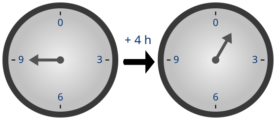

I became interested in modular arithmetic from my interest in calendrical systems (see the standard reference, *Calendrical Calculations*, by Edward M. Reingold and Nachum Dershowitz). Modular arithmetic takes its name from *modulus*, a Latin diminutive of *modus*, meaning “measure”; *modulus*, thus, means “a small measure.” Carl Friedrich Gauss introduced the term in his theory of congruences in *Disquisitiones Arithmeticae* (1801): two integers are congruent modulo a given positive integer when their difference is a multiple of it. The seven-day week provides a familiar example. Ten days from today falls on the same weekday as three days from today, since ten and three differ by seven: \(10\equiv3\pmod{7}\). In this application, modular arithmetic retains our position within the cycle, while disregarding how many complete cycles have elapsed.

For a cartoon illustration, see the following from the Wikipedia page on modular arithmetic, in which the clock uses arithmetic modulo 12: if we add 4 hours to 9 o'clock, we get 1 o'clock, since 13 is congruent to 1 modulo 12.

<p align="center"> 

</p>

An even integer has the form

```math
n=2k,
```

and an odd integer has the form

```math
n=2k+1,
```

where k is an integer. Both definitions single out 2; if we replace it with 3, then we obtain multiples of three, numbers one beyond a multiple of three, and numbers two beyond a multiple of three. Further, if we replace it with 4, and there are four possibilities, and so on.

The generalization is *modular arithmetic*: classify integers by the remainder left after division by a chosen positive integer. Parity is its two-class case. What makes 2 distinctive is that the single question “is it divisible?” already determines the entire remainder. Larger moduli separate several ways of failing divisibility.

While the contemporary mathematics is uniform, its history contains several achievements: recognizing even and odd quantities; proving facts about them; solving problems with specified remainders; developing congruence as a general relation. Egyptian calculations, Greek arithmetic, Chinese and Indian algorithms, and European number theory provide evidence of these practices.

## Generalizing classes

For a positive integer m, every integer n can be written uniquely as

```math
n=mq+r,\qquad q\in\mathbb Z,\qquad 0\le r<m.
```

Imaginatively, the integer q is the quotient; r is the remainder. We usually take m at least 2. Modulus 1 is certainly valid, but everything thereafter has remainder zero.

The familiar definitions follow:

| Modulus | Possible forms | Remainders |
| - | - | - |
| 2 | 2q, 2q + 1 | 0, 1 |
| 3 | 3q, 3q + 1, 3q + 2 | 0, 1, 2 |
| 4 | 4q, 4q + 1, 4q + 2, 4q + 3 | 0, 1, 2, 3 |

For modulus 3, the classes are the multiples of three, the numbers one beyond a multiple of three, and the numbers two beyond a multiple of three. Each class contains infinitely many integers, and every integer belongs to exactly one class.

Note that the same rule covers negative integers, as in

```math
-8=3(-3)+1.
```

The remainder is 1. The convention requires it to be nonnegative and smaller than the modulus; the quotient may be negative.

Existence follows by finding n between consecutive multiples of m. Uniqueness is almost as immediate: if two allowed representations give the same integer, then

```math
mq+r=mq'+r'
\quad\Longrightarrow\quad
m(q-q')=r'-r.
```

The right side has absolute value smaller than m, of which the only multiple of m with that property is zero, so the quotients and remainders agree.

We write

```math
n\equiv r\pmod m
```

to say that n has remainder r on division by m. Thus, "evenness" means "congruence to 0 modulo 2", and "oddness" means "congruence to 1 modulo 2". The word *modulus* simply denotes the divisor that fixes the classification.

## Two is overrated

An integer is odd if it has remainder 1 on division by 2; or, equivalently if it is not divisible by 2. For larger moduli, a number not divisible by 3 may have remainder 1 or remainder 2, and a number not divisible by 4 may have remainder 1, 2, or 3. Generalizing the original distinction, therefore, means keeping either a binary classification into multiples and nonmultiples or the complete classification into all possible remainders.

Only for modulus 2 do these classifications coincide: it is the smallest nontrivial modulus, and the only one with exactly one nonzero class.

Two odd numbers always sum to an even number, but two nonmultiples of 3 can sum to a number in any of the three classes:

```math
1+1\equiv2,\qquad
1+2\equiv0,\qquad
2+2\equiv1
\pmod3.
```

Predicting the class of the sum requires the distinctions merged under the label “nonmultiple of 3”. For every m greater than 2, the same problem arises:

```math
1+(m-1)\equiv0\pmod m,
\qquad
1+1\equiv2\not\equiv0\pmod m.
```

All the summands are nonmultiples, but only the first sum is divisible by m. A binary multiplication rule may still work for certain moduli; a binary addition rule cannot recover the full arithmetic once the classification merges these distinctions.

Parity has a direct interpretation for finite collections: an even number of objects splits into pairs, while an odd number leaves one unpaired. Groups of three or four are equally legitimate things to count; counting in such groups allows more than one nonzero remainder.

## Calculating with remainders

If we knowing a remainder, then we know much less than the original integer; nevertheless, this preserves enough information to calculate the remainder of a sum or product.

Suppose

```math
a=mq+r,\qquad b=ms+t.
```

Then

```math
a+b=m(q+s)+(r+t)
```

and

```math
ab=m(mqs+qt+sr)+rt.
```

The sum r + t determines the remainder of a + b, and the product rt determines the remainder of ab. If either result lies outside the usual range, reduce it again modulo m. Modulo 2, the calculation gives

```math
0+0\equiv0,\qquad
0+1\equiv1,\qquad
1+1\equiv0.
```

These are the familiar parity rules for even plus even, even plus odd, and odd plus odd. Likewise, 1 multiplied by 1 has remainder 1, so the product of two odd integers is odd.

For modulo 3, the corresponding arithmetic has three possible results. For example,

```math
2+2\equiv1\pmod3,
\qquad
2\cdot2\equiv1\pmod3.
```

The arithmetic extends unchanged, provided we retain all three classes.

To see that remainders can also rule out possibilities, square the four possible remainders modulo 4:

```math
0^2\equiv0,\quad
1^2\equiv1,\quad
2^2\equiv0,\quad
3^2\equiv1
\pmod4.
```

Every integer square, therefore, has remainder 0 or 1 modulo 4. A sum of two squares can have remainder 0, 1, or 2, but never 3. Consequently, an integer of the form 4q + 3 cannot be a sum of two integer squares.

## History

Egyptian fraction tables already distinguish the cases we call "even" and "odd". A mathematical fragment from Lahun, from the second millennium BCE, tabulates 2/n for odd denominators from 3 to 21. The Rhind Mathematical Papyrus contains a more extensive version, reaching 101. For even n, 2/n reduces to a single unit fraction. [UCL describes the fragment](https://www.ucl.ac.uk/museums-static/digitalegypt/lahun/uc32159.html) and its [manuscript context](https://www.ucl.ac.uk/museums-static/digitalegypt/lahun/papyri.html).

Parity acquired philosophical significance: in *Metaphysics* I.5, Aristotle reports that Pythagoreans treated odd and even as principles of number and included them among oppositions used to characterize the world, alongside limited and unlimited, and one and many. [Aristotle, *Metaphysics* I.5, 986a](https://classics.mit.edu/Aristotle/metaphysics.1.i.html).

In Euclid’s *Elements*, compiled around 300 BCE, Book VII defines even numbers through division into two equal parts, and odd numbers through failure of that division and their difference by a unit from an even number. Book IX proves rules concerning their sums, differences, products, and divisibility. His numbers are positive whole-number multitudes, with the unit distinguished from a number. Our formulation over all of ℤ extends that setting. [Book VII, definitions 6–10](https://www.euclids-elements.org/elements/books/bookVII/definitions/defVII6/); [Book IX, propositions 21–34](https://www.euclids-elements.org/elements/books/bookIX/).

Euclid distinguishes products of two even numbers from even numbers whose halves are odd. Among positive even numbers greater than 2, these correspond to the alternatives of remainder 0 and remainder 2 modulo 4. Proposition IX.33 treats the latter case. [Euclid, IX.33](https://www.euclids-elements.org/elements/books/bookIX/propositions/propIX33/). In his terminology, an “even-times-odd” number can have remainder 0 modulo 4: 12 is both 4 × 3 and 2 × 6. Euclid’s proposition concerns numbers that are *even-times-odd only*. Equating a historical label with a modern formula can conceal a difference in definition.

Parity could also establish impossibility: Aristotle’s *Prior Analytics* I.23 cites a proof that a square’s diagonal is incommensurable with its side, since commensurability would force a contradiction between odd and even. [Aristotle, *Prior Analytics* I.23, 41a23–30](https://en.wikisource.org/wiki/The_Works_of_Aristotle/Prior_Analytics/Book_I).

A standard modern proof, supposes √2 = a/b in lowest terms. Then

```math
a^2=2b^2.
```

Since the square of an odd integer is odd, a must be even. Writing a = 2c and substituting gives b² = 2c², so b is even too. That contradicts the assumption that the fraction is in lowest terms.

## A Chinese remainder problem

The *Sunzi suanjing*, or *Mathematical Classic of Master Sun*, contains a direct answer to the question of other moduli. The surviving work is generally dated between the third and fifth centuries CE, with uncertainty about its composition. Chapter 3, problem 26, concerns an unknown number of objects that leaves remainder 2 when counted in threes, remainder 3 when counted in fives, and remainder 2 when counted in sevens. Its answer is 23. [MacTutor gives the text and discusses its dating](https://mathshistory.st-andrews.ac.uk/Biographies/Sun_Zi/).

In modern notation, the conditions are

```math
n\equiv2\pmod3,\qquad
n\equiv3\pmod5,\qquad
n\equiv2\pmod7.
```

The text supplies a procedure for other remainders with these same three divisors. The coefficients are 70, 21, and 15. Their role becomes transparent when we calculate their remainders:

| Coefficient | Modulo 3 | Modulo 5 | Modulo 7 |
| - | -: | -: | -: |
| 70 | 1 | 0 | 0 |
| 21 | 0 | 1 | 0 |
| 15 | 0 | 0 | 1 |

Each coefficient contributes to one condition and contributes zero to the others. Multiplying by the desired remainders and adding returns

```math
70(2)+21(3)+15(2)=233.
```

This sum satisfies the conditions. Subtracting two multiples of 105 gives the smaller answer 23. Shen Kangsheng explains the historical rule and its modern reconstruction in [“Historical Development of the Chinese Remainder Theorem,” pp. 285–286](https://people.math.harvard.edu/~knill/crt/lib/Kangsheng.pdf).

All integer solutions are

```math
n=23+105t,\qquad t\in\mathbb Z.
```

To see why the answer repeats with period 105, take any two solutions: their difference is divisible by 3, 5, and 7. Since those divisors are pairwise coprime, it is divisible by their product.

The general Chinese remainder theorem says that, for pairwise coprime positive moduli, every choice of remainders determines exactly one class modulo their product. Sunzi’s procedure is an explicit instance with fixed divisors 3, 5, and 7.

## Algorithms and astronomical calculation

In India, Āryabhaṭa’s *Āryabhaṭīya* of 499 CE gives a repeated-division procedure known as the *kuṭṭaka*, or “pulverizer”, for integer equations and remainder problems; its mathematical section presents the rule in verses 32–33. Such problems belonged to a tradition of mathematical astronomy, concerned with periods and the reckoning of time. [Āryabhaṭa, II.32–33, in W. E. Clark’s translation, pp. 43–49](https://energyenhancement.org/Holy-Books/www.holybooks.com/wp-content/uploads/The-Aryabhatiya-of-Aryabhata.pdf); [MacTutor’s historical account](https://mathshistory.st-andrews.ac.uk/Biographies/Aryabhata_I/).

If a number N is to leave prescribed remainders on division by a and b, write

```math
N=ax+r_1=by+r_2.
```

It follows that

```math
by-ax=r_1-r_2.
```

A remainder problem has become a problem about integer solutions of a linear equation! The modern expression ax ≡ −c modulo b is, likewise, another way of writing ax + c = by.

In China, Qin Jiushao’s *Shushu jiuzhang* of 1247 developed systematic procedures for simultaneous remainder problems, including cases where the divisors have common factors. Qin reportedly attributed an earlier rule to calendar experts at the Board of Astronomy. In that setting, the calculations concern the coordination of recurring periods. [MacTutor’s account of Qin Jiushao](https://mathshistory.st-andrews.ac.uk/Biographies/Qin_Jiushao/).

In modern terms, common factors require compatibility: the two conditions

```math
n\equiv r\pmod a,\qquad n\equiv s\pmod b
```

have a common solution exactly when

```math
r\equiv s\pmod{\gcd(a,b)}.
```

If compatible, they specify a unique class modulo the least common multiple of a and b. For example, remainder 0 modulo 4 and remainder 1 modulo 6 cannot occur together: the first requires an even integer, the second an odd one.

## Congruence as a general relation

European mathematicians also developed general remainder methods even before Gauss. In a paper of 1740, now cataloged as E36, Euler (of course) constructs an algorithm for prescribed remainders, discusses divisors with common factors, and applies the method to dating events through Roman indictions. The wider European history includes several approaches to organizing such problems, as Maarten Bullynck documents. [Euler, E36](https://scholarlycommons.pacific.edu/euler-works/36/); [Bullynck, 2009](https://doi.org/10.1016/j.hm.2008.08.009).

Gauss’s *Disquisitiones arithmeticae* of 1801 made congruence a systematic organizing relation; its opening section defines congruence through divisibility of a difference:

```math
a\equiv b\pmod m
\quad\Longleftrightarrow\quad
m\mid(a-b).
```

It introduces the symbol ≡, includes positive and negative integers, and develops rules for adding and multiplying congruences. In §2, Gauss writes the integers congruent to a modulo m as a + km. [Gauss, §§1–12](https://en.wikisource.org/wiki/Translation:Disquisitiones_Arithmeticae/First_Section). This formulation explains why congruence resembles equality: integers in the same class can replace one another when we calculate remainders of sums and products; their difference is a multiple of the chosen modulus, so the substitution leaves those remainders unchanged. Gauss’s notation is handy, and makes the modulus explicit and organizes calculations through a single relation compatible with addition and multiplication.

## All together

Modulo 4 refines parity:

| Remainder modulo 4 | Parity |
| - | - |
| 0 or 2 | Even |
| 1 or 3 | Odd |

Parity undetermined in modulo 3, since adding 3 preserves the remainder modulo 3 while changing even to odd or odd to even.

For positive integers m and d, there is an exact criterion:

```math
\text{the remainder modulo }m\text{ determines the remainder modulo }d
\quad\Longleftrightarrow\quad d\mid m.
```

If d divides m, any difference divisible by m is also divisible by d. Conversely, 0 and m have the same remainder modulo m. If that always determines their remainder modulo d, then d must divide m.

Some classifications combine, as when knowing a number modulo 2 and modulo 3 determines it modulo 6:

| Remainder modulo 6 | Remainder modulo 2 | Remainder modulo 3 |
| - | -: | -: |
| 0 | 0 | 0 |
| 1 | 1 | 1 |
| 2 | 0 | 2 |
| 3 | 1 | 0 |
| 4 | 0 | 1 |
| 5 | 1 | 2 |

Every pair appears exactly once (this is the Chinese remainder theorem in its smallest nontrivial example).

In modern algebra, the classes modulo m form the quotient ring

```math
\mathbb Z/m\mathbb Z
=\{[0]_m,[1]_m,\ldots,[m-1]_m\}.
```

Here

```math
[r]_m=r+m\mathbb Z
=\{r+mk:k\in\mathbb Z\}.
```

Brackets denote the whole class, of which r is one representative. Addition and multiplication are defined by

```math
[a]_m+[b]_m=[a+b]_m,
\qquad
[a]_m[b]_m=[ab]_m.
```

Our earlier calculations establish that these definitions are independent of the choice of representatives. Changing the modulus can change more than the number of classes: when m is prime, every nonzero class has a multiplicative inverse. The quotient ring is then a field. For example, modulo 3,

```math
[2]_3[2]_3=[1]_3.
```

When m is composite, nonzero classes can multiply to zero. Modulo 4,

```math
[2]_4[2]_4=[0]_4.
```

This explains a qualification to the earlier discussion: nonmultiples of a prime remain nonmultiples when multiplied, even though the binary classification is insufficient for addition. For composite moduli, that multiplication rule can fail as well. The quotient-ring description is our algebraic formulation of the structure. Only the text of an old calculation can show whether its author treated the classes as mathematical objects in this way.

## Moduli and number bases

A base specifies how we write integers using place values, whereas a modulus specifies which differences between integers we ignore for a calculation. In decimal notation, 10 is congruent to 1 modulo 9; every power of 10 is then congruent to 1 as well, so

```math
d_0+10d_1+10^2d_2+\cdots
\equiv d_0+d_1+d_2+\cdots
\pmod9.
```

This is why the sum of the decimal digits has the same remainder modulo 9 as the original integer. The same reasoning works modulo 3. Parity is especially easy to read from the final decimal digit, because 10 is even, a convenience that depends on the notation. Divisibility properties are unchanged when we change the way we write an integer.

## The special case of two

Among nontrivial moduli, 2 is the only one with a single nonzero class; the distinction between divisible and not divisible exhausts its two possible remainders. Three has two nonzero classes and four has three, so for larger moduli, a question about divisibility leaves more unresolved! Retaining those distinctions lets us calculate, exclude impossible solutions, and reconstruct quantities from partial information.

The generalization of parity is, therefore, an arithmetic of the information preserved when we identify integers that differ by a multiple of a chosen modulus.

## Sources and further reading

- University College London, [Lahun fragment UC 32159](https://www.ucl.ac.uk/museums-static/digitalegypt/lahun/uc32159.html) and [the Lahun papyri](https://www.ucl.ac.uk/museums-static/digitalegypt/lahun/papyri.html). Curatorial descriptions of the Egyptian fraction table and its manuscript setting.

- Euclid, *Elements*, [VII, definitions 6–10](https://www.euclids-elements.org/elements/books/bookVII/definitions/defVII6/), and [IX, propositions 21–34](https://www.euclids-elements.org/elements/books/bookIX/). Aristotle, [*Metaphysics* I.5](https://classics.mit.edu/Aristotle/metaphysics.1.i.html) and [*Prior Analytics* I.23](https://en.wikisource.org/wiki/The_Works_of_Aristotle/Prior_Analytics/Book_I).

- Shen Kangsheng, [“Historical Development of the Chinese Remainder Theorem,”](https://people.math.harvard.edu/~knill/crt/lib/Kangsheng.pdf) *Archive for History of Exact Sciences* 38 (1988), 285–305. See also MacTutor’s [Sun Zi](https://mathshistory.st-andrews.ac.uk/Biographies/Sun_Zi/) entry for the dating problem.

- Āryabhaṭa, *The Āryabhaṭīya of Āryabhaṭa*, translated by Walter Eugene Clark (University of Chicago Press, 1930), [II.32–33 and accompanying notes](https://energyenhancement.org/Holy-Books/www.holybooks.com/wp-content/uploads/The-Aryabhatiya-of-Aryabhata.pdf), pp. 43–49.

- Leonhard Euler, [E36](https://scholarlycommons.pacific.edu/euler-works/36/), published 1740. Maarten Bullynck, [“Modular arithmetic before C. F. Gauss: Systematizations and discussions on remainder problems in 18th-century Germany,”](https://doi.org/10.1016/j.hm.2008.08.009) *Historia Mathematica* 36 (2009), 48–72.

- Carl Friedrich Gauss, *Disquisitiones arithmeticae* (1801), [§§1–12](https://en.wikisource.org/wiki/Translation:Disquisitiones_Arithmeticae/First_Section). The opening section is a short primary text on the mathematical question that starts this post.
